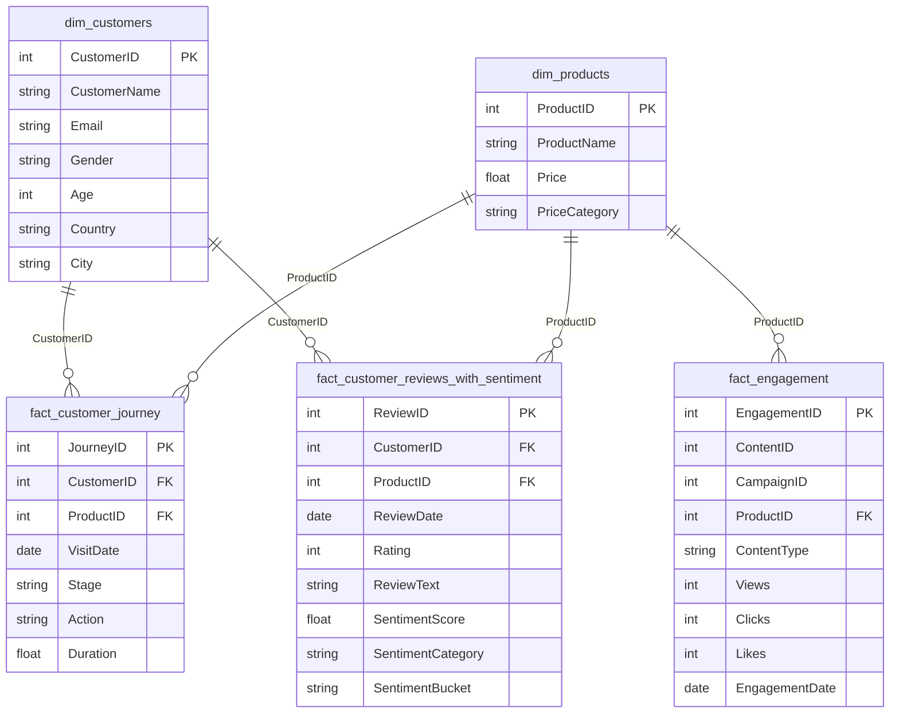
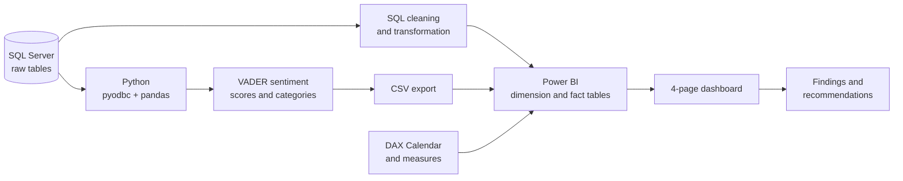

# DataAnalystPortfolioProject_PBI_SQL_Python_MarketingAnalytics
# Marketing Analytics: Conversion, Engagement and Customer Sentiment


An end-to-end analytics project for **ShopEasy**, a fictional online retailer whose marketing spend is rising while engagement and conversions are not. The project takes raw marketing tables in SQL Server through cleaning, sentiment analysis in Python, and a four-page Power BI dashboard that answers the marketing team's questions.


*Overview page of the Power BI dashboard, filtered to 2024.*

## Table of Contents

1. [Project Overview](#project-overview)
2. [Business Problem](#business-problem)
3. [Objectives and KPIs](#objectives-and-kpis)
4. [Tools and Technologies](#tools-and-technologies)
5. [Dataset Description](#dataset-description)
6. [Data Model](#data-model)
7. [End-to-End Workflow](#end-to-end-workflow)
8. [SQL Data Cleaning and Transformation](#sql-data-cleaning-and-transformation)
9. [Python Sentiment Analysis](#python-sentiment-analysis)
10. [Power BI Dashboard](#power-bi-dashboard)
11. [Key Findings](#key-findings)
12. [Recommendations](#recommendations)
13. [Limitations and Notes](#limitations-and-notes)
14. [Repository Structure](#repository-structure)
15. [How to Run the Project](#how-to-run-the-project)
16. [Skills Demonstrated](#skills-demonstrated)
17. [Conclusion](#conclusion)
18. [Credits](#credits)

---

## Project Overview

The marketing and customer experience managers at ShopEasy want to know why customers are engaging and buying less despite higher campaign investment, and what customers actually think of the products. This project answers that in three parts:

| Part | What was done | Tool |
|---|---|---|
| Prepare the data | Joined, de-duplicated, standardised and reshaped six raw tables | SQL Server |
| Enrich the data | Scored every customer review for sentiment and compared it with the star rating | Python (pandas, NLTK VADER) |
| Communicate the results | Built a four-page interactive dashboard with a date table and custom measures | Power BI, DAX |

## Business Problem

The business case (see [`docs/Business_Case.pptx`](docs/Business_Case.pptx)) is framed as two emails to the analyst, from the Marketing Manager and the Customer Experience Manager. The reported symptoms:

- **Reduced customer engagement** with the site and marketing content.
- **Lower conversion rates**: fewer visitors become paying customers.
- **High marketing spend** that is not delivering the expected return.
- **No structured view of customer feedback**, even though reviews and social media comments exist.

## Objectives and KPIs

| Goal | Question the analysis answers |
|---|---|
| Increase conversion rate | At which stages and for which products do visitors drop off? |
| Enhance customer engagement | Which content types and which months drive the most views, clicks and likes? |
| Improve customer feedback scores | What do ratings and review sentiment say about satisfaction, and where do text and rating disagree? |

KPIs named in the business case: Conversion Rate, Customer Engagement Rate, Average Order Value, Customer Feedback Score.
This dashboard implements Conversion Rate, Views/Clicks/Likes (engagement) and Average Rating (feedback score). **Average Order Value is not implemented**, because the dataset has no order values.

## Tools and Technologies

| Technology | Role in this project |
|---|---|
| **SQL Server (T-SQL)** | Storage of the raw tables; joins, de-duplication, string and date cleaning, price banding |
| **Python 3** | Pulls reviews from SQL Server and runs the sentiment analysis |
| **pandas** | Holds the review table in memory, adds the sentiment columns, exports to CSV |
| **pyodbc** | Connects Python to SQL Server |
| **NLTK / VADER** | Rule-based sentiment scoring of review text |
| **Power BI** | Data model, report pages, slicers and charts |
| **DAX** | Calendar table and the KPI measures |

## Dataset Description

The source is a SQL Server database named `PortfolioProject_MarketingAnalytics`. The row counts below are from the cleaned tables loaded into the Power BI model.

| Table (Power BI) | Raw table(s) | Rows | Content |
|---|---|---:|---|
| `dim_customers` | `customers`, `geography` | 100 | Customer name, email, gender, age, country, city. 10 countries, with Spain the largest group (18 customers) |
| `dim_products` | `products` | 20 | Product name, price, price category (High 10, Low 6, Medium 4) |
| `fact_customer_journey` | `customer_journey` | 4,011 | One row per customer action on the site: Stage (Homepage, ProductPage, Checkout), Action (View, Click, Drop-off, Purchase), Duration |
| `fact_engagement` | `engagement_data` | 3,519 | Views, clicks and likes per piece of content, across 20 campaigns. Content types: Blog, Social Media, Video |
| `fact_customer_reviews_with_sentiment` | `customer_reviews` | 1,363 | Rating (1 to 5) and review text, plus the sentiment columns added in Python |
| `Calendar` | n/a (DAX) | 1,096 | Date table, 1 Jan 2023 to 31 Dec 2025 |

Journey, engagement and review records all span **January 2023 to December 2025**. The dashboard screenshots and the figures in this README are for **2024**, selected with the year slicer.

## Data Model

The Power BI model follows a star schema: fact tables hold events, dimension tables hold descriptive attributes.



A separate `Calendar` table (DAX) supplies year, month, quarter and weekday fields for the date slicers and monthly trend charts.

## End-to-End Workflow



1. Raw tables sit in SQL Server.
2. SQL queries clean each table. Power BI loads these queries directly through its SQL Server connector.
3. Review text is pulled into Python, scored for sentiment and exported as `fact_customer_reviews_with_sentiment.csv`, which Power BI loads as a CSV.
4. In Power BI, a DAX calendar table and measures are added, and the report pages are built.
5. Results are summarised in the final presentation ([`docs/Final_Presentation.pptx`](docs/Final_Presentation.pptx)).

## SQL Data Cleaning and Transformation

All scripts are in [`sql/`](sql/). Each one prepares a table for the Power BI model.

| Script | Problem | Technique |
|---|---|---|
| [`01_customers_geography.sql`](sql/01_customers_geography.sql) | Customer and location data live in separate tables | `LEFT JOIN` on `GeographyID`, so every customer is kept even without a location match |
| [`02_products_price_category.sql`](sql/02_products_price_category.sql) | Prices are continuous, which is hard to compare across products | `CASE` banding: under 50 is Low, 50 to 200 is Medium, above 200 is High |
| [`03_identify_duplicate_journeys.sql`](sql/03_identify_duplicate_journeys.sql) | Some journey events are recorded more than once | `ROW_NUMBER()` partitioned by customer, product, date, stage and action; `row_num > 1` marks a duplicate |
| [`04_clean_customer_journey.sql`](sql/04_clean_customer_journey.sql) | Duplicates, inconsistent `Stage` casing, missing durations | Keep `row_num = 1`, `UPPER(Stage)`, `COALESCE(Duration, avg_duration)` with `AVG() OVER (PARTITION BY VisitDate)` |
| [`05_clean_customer_reviews.sql`](sql/05_clean_customer_reviews.sql) | Extra spaces inside review text | `REPLACE(ReviewText, '  ', ' ')` |
| [`06_clean_engagement.sql`](sql/06_clean_engagement.sql) | Views and clicks stored in one text field, inconsistent content labels, newsletter rows, text dates | `CHARINDEX` with `LEFT`/`RIGHT` to split the field, `REPLACE` + `UPPER` for labels, `FORMAT` for dates, `WHERE ContentType != 'Newsletter'` |

<details>
<summary><b>Example: removing duplicates and filling missing durations</b></summary>

```sql
SELECT
    JourneyID, CustomerID, ProductID, VisitDate, Stage, Action,
    COALESCE(Duration, avg_duration) AS Duration
FROM (
    SELECT
        JourneyID, CustomerID, ProductID, VisitDate,
        UPPER(Stage) AS Stage,
        Action,
        Duration,
        AVG(Duration) OVER (PARTITION BY VisitDate) AS avg_duration,
        ROW_NUMBER() OVER (
            PARTITION BY CustomerID, ProductID, VisitDate, UPPER(Stage), Action
            ORDER BY JourneyID
        ) AS row_num
    FROM dbo.customer_journey
) AS subquery
WHERE row_num = 1;
```

`ROW_NUMBER()` numbers identical events in order of `JourneyID`; keeping only number 1 removes the repeats. `AVG() OVER (PARTITION BY VisitDate)` gives the average duration for that day, and `COALESCE` uses it only where `Duration` is empty.
</details>

<details>
<summary><b>Example: splitting combined views and clicks</b></summary>

```sql
SELECT
    EngagementID, ContentID, CampaignID, ProductID,
    UPPER(REPLACE(ContentType, 'Socialmedia', 'Social Media')) AS ContentType,
    LEFT(ViewsClicksCombined, CHARINDEX('-', ViewsClicksCombined) - 1) AS Views,
    RIGHT(ViewsClicksCombined,
          LEN(ViewsClicksCombined) - CHARINDEX('-', ViewsClicksCombined)) AS Clicks,
    Likes,
    FORMAT(CONVERT(DATE, EngagementDate), 'dd.MM.yyyy') AS EngagementDate
FROM dbo.engagement_data
WHERE ContentType != 'Newsletter';
```

The raw column stores values like `views-clicks`. `CHARINDEX` finds the hyphen, `LEFT` takes everything before it (views) and `RIGHT` everything after it (clicks). Newsletter rows are excluded from the analysis.
</details>

## Python Sentiment Analysis

Star ratings are a blunt measure. A customer can give 4 stars and write a complaint, or 2 stars with a neutral comment. [`python/customer_sentiment_analysis.py`](python/customer_sentiment_analysis.py) scores the review text and compares it with the rating.

**Steps**

1. Connect to SQL Server with `pyodbc` and load the reviews into a pandas DataFrame.
2. Score each `ReviewText` with VADER and keep the **compound score** (-1 most negative to +1 most positive).
3. Combine the compound score with the rating to assign a `SentimentCategory`.
4. Assign a `SentimentBucket` (score range) for charting.
5. Export `fact_customer_reviews_with_sentiment.csv` for Power BI.

**Why VADER:** it is a rule-based model designed for short, informal text, needs no training data, and produces a score that is easy to explain to a business audience.

**Category logic** (text sentiment: compound above 0.05 is positive, below -0.05 is negative, otherwise neutral)

| Text sentiment | Rating 4-5 | Rating 3 | Rating 1-2 |
|---|---|---|---|
| Positive | Positive | Mixed Positive | Mixed Negative |
| Neutral | Positive | Neutral | Negative |
| Negative | Mixed Positive | Mixed Negative | Negative |

"Mixed" categories flag reviews where the text and the rating disagree, which are the ones worth reading first.

<details>
<summary><b>Code: scoring and categorising</b></summary>

```python
sia = SentimentIntensityAnalyzer()

def calculate_sentiment(review):
    return sia.polarity_scores(review)['compound']

def categorize_sentiment(score, rating):
    if score > 0.05:
        if rating >= 4:   return 'Positive'
        elif rating == 3: return 'Mixed Positive'
        else:             return 'Mixed Negative'
    elif score < -0.05:
        if rating <= 2:   return 'Negative'
        elif rating == 3: return 'Mixed Negative'
        else:             return 'Mixed Positive'
    else:
        if rating >= 4:   return 'Positive'
        elif rating <= 2: return 'Negative'
        else:             return 'Neutral'

def sentiment_bucket(score):
    if score >= 0.5:          return '0.5 to 1.0'
    elif 0.0 <= score < 0.5:  return '0.0 to 0.49'
    elif -0.5 <= score < 0.0: return '-0.49 to 0.0'
    else:                     return '-1.0 to -0.5'

customer_reviews_df['SentimentScore']    = customer_reviews_df['ReviewText'].apply(calculate_sentiment)
customer_reviews_df['SentimentCategory'] = customer_reviews_df.apply(
    lambda row: categorize_sentiment(row['SentimentScore'], row['Rating']), axis=1)
customer_reviews_df['SentimentBucket']   = customer_reviews_df['SentimentScore'].apply(sentiment_bucket)
```
</details>

## Power BI Dashboard

The report ([`powerbi/Marketing_Analytics_Dashboard.pbix`](powerbi/Marketing_Analytics_Dashboard.pbix)) has four pages. Every page has product, year and month slicers.

| Page | Contents |
|---|---|
| **Overview** | Conversion rate, views, clicks, likes and average rating as cards; monthly trends; conversion rate and rating by product; views, clicks, likes funnel |
| **Conversion Details** | Conversion rate by month and by product, product-by-month matrix, funnel of customer journeys by action |
| **Social Media Details** | Views, clicks and likes by month; views by content type and month; product and content type matrix |
| **Customer Review Details** | Rating and sentiment distributions, average rating by sentiment over time, review table, country and sentiment slicers, scatter of customers by rating and review count |

**DAX measures** ([`dax/measures.dax`](dax/measures.dax)). The core KPI:

```dax
Conversion Rate =
VAR TotalVisitors  = CALCULATE ( COUNT ( fact_customer_journey[JourneyID] ),
                                 fact_customer_journey[Action] = "View" )
VAR TotalPurchases = CALCULATE ( COUNT ( fact_customer_journey[JourneyID] ),
                                 fact_customer_journey[Action] = "Purchase" )
RETURN
    IF ( TotalVisitors = 0, 0, DIVIDE ( TotalPurchases, TotalVisitors ) )
```

Conversion rate here is **purchase events divided by view events** in the journey table. Because it is a ratio of event counts, not of unique visitors, it can exceed 100% for a single product in a single month when the counts are small (see the matrix below).

**Conversion rate by product and month**


**Engagement**

| Views, clicks and likes by month | Views by content type |
|---|---|
|  |  |

**Customer reviews**

| Reviews by rating | Reviews by sentiment category |
|---|---|
|  |  |

## Key Findings

All figures are for **2024**, read from the dashboard.

### Conversion

- Overall conversion rate is **8.5%**.
- The monthly rate swings widely: highest in **January (18.5%)**, then **September (15.7%)**, lowest in **May (4.3%)**, with **October at 5.0%** and **December at 10.2%**. The chart shows no value for November.
- By product, **Kayak (21.4%)** and **Ski Boots (20.0%)** convert best, followed by Surfboard (13.9%). The lowest are **Boxing Gloves (2.6%)**, Climbing Rope (2.7%) and Cycling Helmet (2.9%).
- Product-by-month rates are volatile and some exceed 100% (for example Ski Boots in January at 150%), so month-level product results rest on very few events.

### Engagement

- Total **2,982,369 views**, **458,345 clicks** (15.37% of views) and **73,618 likes** (2.47% of views).
- Views were highest in **May (326,805)**, March (321,860) and January (306,720), and lowest in **October (161,251)**. From the monthly labels, views in the first half of the year total about 1.75 million against about 1.23 million in the second half.
- Clicks and likes stay low relative to views in every month.
- By content type, Blog has the highest single-month views (May, then March). Social Media and Video are steadier, and Social Media leads in the last quarter of the year.

### Customer feedback

- Average rating is **3.7** across **446 reviews**, below the 4.0 target used in the presentation.
- Rating distribution: 1 star 26, 2 stars 57, 3 stars 88, 4 stars 140, 5 stars 135.
- Sentiment categories: **Positive 275**, **Negative 82**, **Mixed Negative 60**, **Mixed Positive 21**, **Neutral 8**.
- Average rating by product ranges from about 3.5 (for example Tennis Racket) to 4.1 (Football Helmet).
- Monthly average rating ranges from about 3.4 in January to about 4.0 in April.

## Recommendations

These are suggestions based on the findings above. They have not been tested.

| Area | Recommendation | Based on |
|---|---|---|
| Conversion | Concentrate promotion on products that already convert well (Kayak, Ski Boots, Surfboard) and plan campaigns around the strong months | Product and month conversion rates |
| Conversion | Investigate the weakest products and months (Boxing Gloves, Climbing Rope, Cycling Helmet; May and October) before spending more on them | Lowest conversion rates |
| Engagement | Test stronger calls to action and new formats such as interactive video or user-generated content, especially in the second half of the year | Falling views, low click and like rates |
| Engagement | Review how Blog content performed in its peak months and reuse what worked | Blog view peaks |
| Feedback | Read the Mixed Negative and Negative reviews first to find recurring issues, then follow up with those customers | Sentiment categories |
| Feedback | Prioritise the lowest-rated products (around 3.5) for improvement work | Average rating by product |

## Limitations and Notes

- **Single-year view.** The dataset covers 2023 to 2025; the findings here are for 2024 only. Other years can be viewed with the year slicer.
- **Small counts at product-month level.** Conversion percentages for individual products in individual months are based on a handful of events and should not be read as trends.
- **Conversion definition.** The rate compares purchase events with view events, not unique visitors, and does not track a customer from view to purchase.
- **Limited review text variety.** The 1,363 reviews contain only 102 distinct texts, and many score 0.0 (neutral) with VADER. Sentiment categories therefore depend heavily on the star rating. Treat sentiment results as a demonstration of the method, not as a rich text analysis.
- **Review cleaning.** Review text in the exported CSV still contains double spaces, which indicates the Python script read a table that did not include the `REPLACE` cleaning step from `05_clean_customer_reviews.sql`.
- **Journey table in the included `.pbix`.** The saved `fact_customer_journey` still contains 79 duplicate rows. The effect on the 2024 conversion rate is negligible (8.45% against 8.48%), but loading only the cleaning query in `04_clean_customer_journey.sql` and refreshing would remove them.
- **Average Order Value** from the business case is not covered because the data has no order values.

## Repository Structure

```text
marketing-analytics-project/
├── README.md
├── sql/
│   ├── 01_customers_geography.sql
│   ├── 02_products_price_category.sql
│   ├── 03_identify_duplicate_journeys.sql
│   ├── 04_clean_customer_journey.sql
│   ├── 05_clean_customer_reviews.sql
│   └── 06_clean_engagement.sql
├── python/
│   └── customer_sentiment_analysis.py
├── dax/
│   ├── calendar_table.dax
│   └── measures.dax
├── powerbi/
│   └── Marketing_Analytics_Dashboard.pbix
├── docs/
│   ├── Business_Case.pptx
│   └── Final_Presentation.pptx
└── images/
    └── (dashboard screenshots)
```

## How to Run the Project

**Requirements:** SQL Server (Express is enough) with SQL Server Management Studio, Python 3.9+, Power BI Desktop, and an ODBC driver for SQL Server.

1. **Database.** Create a database named `PortfolioProject_MarketingAnalytics` and load the raw tables: `customers`, `geography`, `products`, `customer_journey`, `engagement_data`, `customer_reviews`. *(The database backup is not included in this repository; see the note below.)*
2. **SQL.** Run the scripts in `sql/` to inspect and validate the cleaning logic.
3. **Python.**
   ```bash
   pip install pandas pyodbc nltk
   ```
   Edit the `Server=` value in the connection string in `python/customer_sentiment_analysis.py`, then run it. It writes `fact_customer_reviews_with_sentiment.csv`.
4. **Power BI.** Open the `.pbix` file. Update the SQL Server name under *Transform data > Data source settings*, and point the reviews CSV source to the file created in step 3. Refresh the data.

## Skills Demonstrated

| Area | Evidence in this project |
|---|---|
| SQL | Joins, CTE and window functions (`ROW_NUMBER`, `AVG OVER`), `CASE`, `COALESCE`, string and date functions |
| Data cleaning | De-duplication, standardising labels, splitting combined fields, handling missing values, filtering out-of-scope data |
| Python | Database access with `pyodbc`, pandas transformations, applying custom functions across a DataFrame, CSV export |
| NLP | Sentiment scoring with VADER and combining text sentiment with ratings |
| Data modelling | Star schema with dimension and fact tables, date table |
| Power BI and DAX | Calculated table, KPI measures, multi-page report with slicers, funnel, line, column, matrix and scatter visuals |
| Business analysis | Translating a business case into KPIs, separating findings from recommendations, noting data limitations |

## Conclusion

The project covers the full analytics cycle: raw data in SQL Server is cleaned and shaped, review text is enriched with sentiment in Python, and the results are modelled and visualised in Power BI. For 2024 it shows an overall conversion rate of 8.5% with large month-to-month swings, views that fall in the second half of the year while clicks and likes stay low, and an average rating of 3.7 with a clear group of mixed and negative reviews to follow up on.

## Credits

The business case and dataset come from a guided portfolio project series by **Ali Ahmad** (his name appears in the source presentation and Power BI file). The SQL, Python and Power BI work in this repository is documented as it exists in the project files.

<!-- Add your name, LinkedIn and GitHub links here. -->
